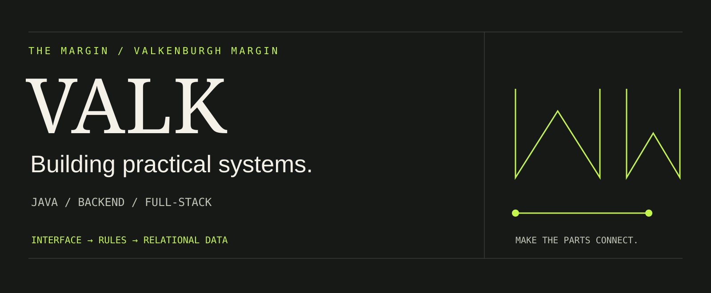
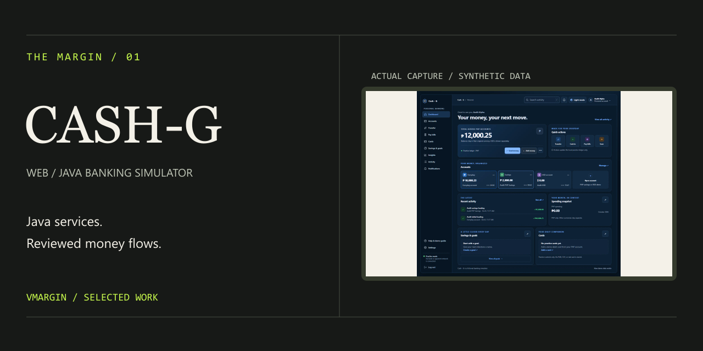
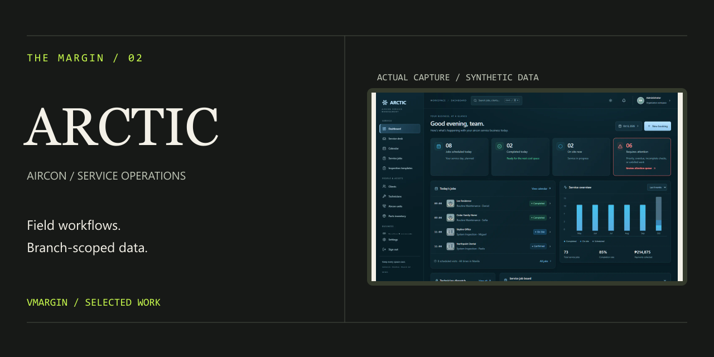
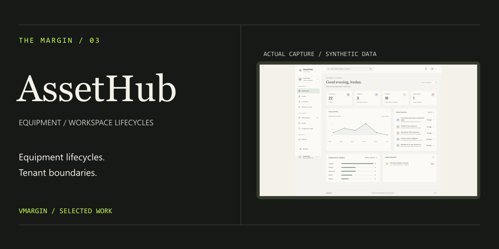

# Valkenburgh Margin

**Software Developer · Java, backend, and full-stack applications**

Open to junior software development roles.

I'm Valk, a Computer Engineering graduate building software around practical workflows: moving money in a simulator, coordinating service jobs, and tracking equipment across workspaces. I care about how the interface, application rules, and relational data fit together.

[Portfolio](https://vmargin.github.io/) · [Résumé](https://vmargin.github.io/documents/valkenburgh-margin-resume.pdf) · [LinkedIn](https://www.linkedin.com/in/vmargin/) · [Email](mailto:marginvalkenburgh@gmail.com)

## Selected work

### 01 / CASH-G Web

A Java banking simulator adapted into a Spring Boot and Thymeleaf web application. Reviewed transfers, JDBC transactions, account activity, and savings goals use synthetic data.

**Engineering focus:** service-layer money rules and transaction-backed ledger changes. I hand-coded desktop v1; web v2 is an AI-assisted adaptation whose features and outputs I review.

[Source](https://github.com/vmargin/cashg.onrender.com) · [Case study](https://vmargin.github.io/projects/cash-g/) · Hosted demo unavailable at the October 22, 2026 check; local demo instructions are in the repository.

### 02 / ARCTIC AIRCON

A service-management workspace connecting requests, estimates, scheduling, field work, inventory, invoices, and payments.

**Engineering focus:** organization/branch access and ordered operational workflows. I gathered requirements, defined workflows, made data-architecture decisions, and reviewed outputs. Development and deployment are AI-assisted.

[Source](https://github.com/vmargin/arctic) · [Demo](https://arcticaircon.vercel.app/) · [Case study](https://vmargin.github.io/projects/arctic/)

### 03 / ERL AssetHub

A multi-tenant equipment workspace covering checkout, returns, maintenance, inventory audits, and organization permissions.

**Engineering focus:** tenant-scoped data and lifecycle history. I hand-coded the original; v2 frontend redesign/deployment and v3 redesign/development/deployment are AI-assisted, with user research informing v3 feature selection.

[Source](https://github.com/vmargin/assethub) · [Demo](https://erlassethub.vercel.app/) · [Case study](https://vmargin.github.io/projects/assethub/)

## Engineering foundations

| Project | What it contains |
| --- | --- |
| [Java desktop banking](https://github.com/vmargin/banking-app) | Swing interfaces, Java services, JDBC persistence, PostgreSQL, and JUnit tests. The separate desktop foundation of CASH-G. |
| [Task manager API](https://github.com/vmargin/task-manager-api) + [React client](https://github.com/vmargin/task-manager-client) | A paired learning project for JWT authentication, user-owned tasks, and a small React interface. The hosted API is unavailable at the latest check. |
| [Java coursework](https://github.com/vmargin/ciicc92026) | Chapter exercises, task sheets, and original learning attempts. |
| [Portfolio source](https://github.com/vmargin/vmargin.github.io) | React/TypeScript case studies, real application captures, and GitHub Pages publication. |

## Technologies used in my projects

| Area | Technologies |
| --- | --- |
| Java and backend | Java 21, Spring Boot, Thymeleaf, Swing, JDBC, Node.js, Express |
| Web interfaces | React, TypeScript, JavaScript, Vite, Tailwind CSS, TanStack Query |
| Data | PostgreSQL, Prisma, H2 for the CASH-G local demo |
| Checks and tooling | JUnit, Maven, Node.js Test Runner, Jest, Playwright, Git, GitHub Actions |

This describes project usage, including AI-assisted work; it is not a proficiency rating.

## Education and training

- **BS Computer Engineering**, Polytechnic University of the Philippines, 2020.
- **Java Programming NC III training**, CIICC / TESDA, completed July–August 2026. Training completion is distinct from holding an NC III assessment credential.
- **AWS Cloud Quest: Cloud Practitioner**, course completed September 5, 2026. This is course completion, not the AWS Certified Cloud Practitioner exam certification. [Completion document](https://vmargin.github.io/documents/aws-cloud-quest-completion.pdf).

## Start a conversation

For junior Java, backend, or full-stack opportunities: [LinkedIn](https://www.linkedin.com/in/vmargin/) or [email](mailto:marginvalkenburgh@gmail.com).

Project screenshots show synthetic practice data. [Artwork and image sources](assets/README.md). Links and demo availability checked October 22, 2026.
